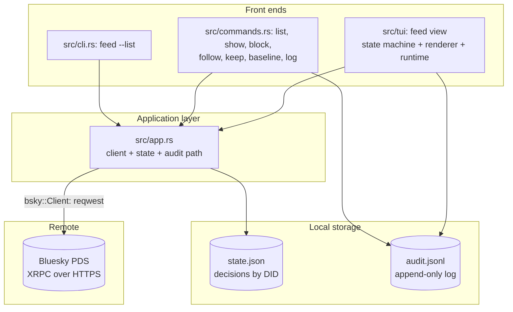
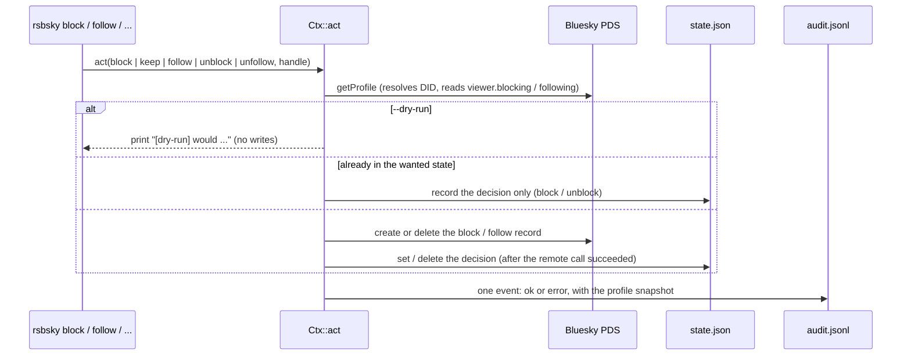
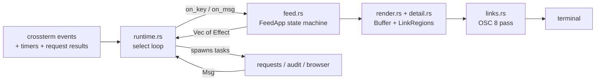
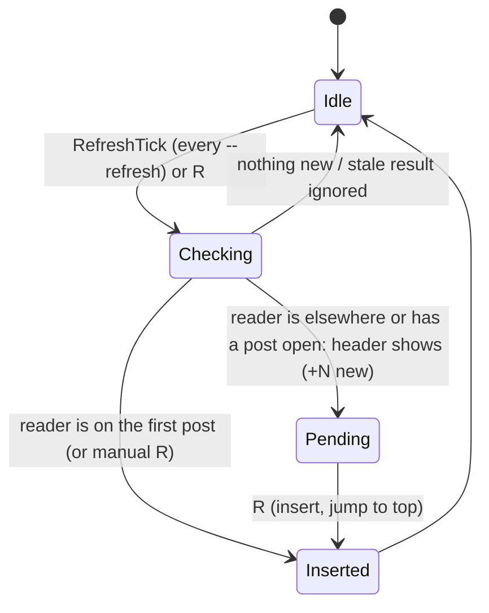

# Architecture: rsbsky

This document describes the components and data flow of rsbsky, a Rust port of [bskyban](../bskyban). For usage and flags see `README.md`, for dependencies `PKG.md`, for what is and is not compatible with the Go original `docs/compat.md`, and for the port's phases `plan.md`.

## High-Level Overview

rsbsky is one binary plus a library crate. `src/main.rs` is four lines; everything lives in the library (`src/lib.rs`) so tests, the examples and the binary share it. Like the original it offers two front ends over the same code: an interactive terminal UI (ratatui) and scriptable subcommands. It talks only to the user's PDS over HTTPS and keeps two small local files, in the same formats as the Go tool so the two can share them.



Modules depend only downward:

```
main -> cli -> tui, commands -> app -> store, bsky -> termtext
```

| Module | Responsibility |
|--------|----------------|
| `cli` | clap definitions, environment resolution, dispatch order, exit codes, `feed --list` and `format_post` |
| `commands` | The headless subcommands: `log`, `list`, `baseline`, `show`, and `block / unblock / follow / unfollow / keep` with `--dry-run` and stdin `-` |
| `app` | `App` (client + state + audit): `is_new`, `feed_candidates`, `followers`, and `create_for` / `delete_for` / `viewer_uri` mapping a decision to a block or follow record |
| `bsky` | `Client` (XRPC), and the data model: `Profile`, `Post`, `FeedItem`, `Repost` in `profile.rs`, `post.rs`, `feed.rs`; record writes in `records.rs` |
| `store` | `State` (`state.json`, atomic writes, rollback) and `Audit` (`audit.jsonl` writer and reader), plus the default file locations |
| `tui` | `feed.rs` (the pure state machine), `render.rs` (drawing), `detail.rs` (detail-view lines), `actions.rs` (decisions), `picker.rs` (link picker, browser launch), `links.rs` (OSC 8), `runtime.rs` (event loop, terminal guard), `theme.rs` |
| `termtext` | Making untrusted text safe for a terminal: sanitizing, URL detection, link-preserving wrapping, width truncation, `human_age` |

## Components

### 1. Entry point and dispatch (`src/cli.rs`)

`real_main` parses with clap, then `run` dispatches in a fixed order that mirrors the Go tool:

1. `log` and `themes` run immediately and **need no login**.
2. For `feed`, `posts` and `review` the theme is validated *before* credentials are read, so an unknown `--theme` or `BSKYBAN_THEME` exits 2 without a password or the network. Printed lists (`feed --list`, `posts --list/--json`) deliberately ignore `BSKYBAN_THEME`.
3. `BSKY_HANDLE` / `BSKY_APP_PASSWORD` are read, the state and audit paths resolved, `state.json` loaded, and `Client::login` creates a session.
4. The command runs: `feed --list` prints, `feed` starts the TUI, the rest go through `commands::Ctx`. Commands that are not ported yet fail with `not yet implemented ... (planned: phase N)`.

Exit codes: `0` ok, `1` failure, `2` usage. clap handles flag and subcommand errors; `CliError::{Usage, Failure, Plain}` carries the rest. Option validation that Go did after login (a missing identifier) happens before it here, which is a documented difference.

### 2. Bluesky client (`src/bsky`)

A hand-written client with no SDK. `Client::send` builds `<pds>/xrpc/<nsid>?<sorted query>`, attaches `Authorization: Bearer <accessJwt>`, and turns any non-200 response into `nsid: message (error)` (or `nsid: HTTP 503` when there is no error body), sanitizing both strings. There is a 30 second timeout. `login` uses `com.atproto.server.createSession` and keeps only the token, DID and handle; there is no refresh.

- **Reads:** `getTimeline`, `getProfile`, `getProfiles` (batches of 25), `getFollowers`, `getFollows`, `getAuthorFeed` (`posts_with_replies`).
- **Writes:** `createRecord` / `deleteRecord` in your repo: `block`, `follow` create `app.bsky.graph.block|follow` records and return the URI; `unblock`, `unfollow` delete by the URI's last segment.
- **Parsing:** every response struct is `#[serde(default)]` with an `nz` helper so `null` equals missing. `FeedEntry::item` builds a `FeedItem`; `describe_embed`, `embed_link` and `view_context` extract images, video, link cards and quoted posts; `expand_links` replaces truncated link text with the real URL using the facet byte offsets.
- **Sanitizing:** `Profile` strings and API error messages pass through `termtext::sanitize`; post text is kept raw (as in Go) and sanitized at display and in `feed --list` lines.

### 3. Local storage (`src/store`)

- **State** is `BTreeMap<did, Entry{handle, decision, at}>`; `decision` is `blocked`, `kept`, `followed` or `skipped`. Loading accepts what Go accepts (`null` entries and fields, missing `at`, unknown keys) and rejects what Go rejects (arrays, malformed JSON). `save` writes `state.json.tmp` (0600) and renames it, creating the directory 0700; `set`, `put` and `delete` **roll back the in-memory change if the save fails**. Timestamps are written with Go's `RFC3339Nano` shape and existing entries keep their original value and offset when the file is rewritten.
- **Audit** is append-only JSON Lines (`AuditEvent`, `Snapshot`): `ts` (UTC, seconds), `action`, `did`, `handle`, `source` (`cli`, `tui:following`), `via`, `record`, `prev`, `detail`, `dryRun`, `ok`, `error`, and a profile snapshot whose counts are present only when the full profile was loaded. `read_audit` tolerates blank and `null` lines and reports `path line N: ...` for bad ones. `rsbsky log` reads it without logging in.

Both default to `~/.local/state/bskyban/` (or `$XDG_STATE_HOME/bskyban` if absolute) and can be set with `BSKYBAN_STATE` / `BSKYBAN_AUDIT`.

### 4. Headless decisions (`src/commands.rs`)

`Ctx::act` is the port of Go's `CLI.act`: fetch the profile, print what will happen (`[dry-run] would ...` or the action), change the record, **then** save the decision, and always record one audit event with the profile snapshot, including for dry runs and failures.



A failed audit write is a stderr warning and never hides the action's result. `App::feed_candidates` builds the repost-author list for `feed --list`: the original author of each repost in `--pages` pages of 100 timeline items, minus yourself, people you follow or block, and anyone with a decision (skipped ones return with `--backlog`), first appearance first, with every reposter collected.

### 5. The feed TUI (`src/tui`)

The UI is split so the logic can be tested without a terminal:



- **`FeedApp` (`feed.rs`)** owns all UI state (items, cursor, scroll, pending posts, profiles, picker, follows browser, history, `State`) and has two entry points, `on_key(KeyEvent, Now)` and `on_msg(Msg, Now)`, each returning `Vec<Effect>`. It does no network I/O and reads no clock (`Now` is injected); its only side effect is the `state.json` write that decisions need. Results carry request ids, so stale or repeated answers are ignored and requests cannot overlap.
- **Effects** (`LoadPage`, `Check`, `FetchProfile`, `Act`, `LoadFollows`, `Open`, `Audit`, `ScheduleAnim`, `Quit`) are performed by `runtime.rs`, which spawns tokio tasks that send a `Msg` back. On quit every outstanding task is aborted, so a slow request never delays exit, except while an action is running (see Resilience).
- **`render.rs`** draws into a ratatui `Buffer`: title row, list or two-panel detail, and a footer pinned to the bottom with the error, status and wrapped key hints. It returns the hyperlinks as `LinkRegion`s instead of putting escape codes in cells.
- **`links.rs`** is the OSC 8 strategy. ratatui measures each cell's symbol with `unicode-width`, so raw escapes in symbols corrupt its diffing. Instead, after every flushed frame a pass re-prints just the link cells, each wrapped in its own OSC 8 open/close; link cells are re-sent on **every** frame (a changed target is never stale), and cells that stopped being links are re-printed plain so the terminal drops the old link.
- **`runtime.rs`** owns the terminal: `TerminalGuard` enters raw mode and the alternate screen and restores them on drop, a panic hook restores before the message prints, `SIGTERM`/`SIGHUP` quit cleanly, and startup never queries the terminal (a cursor-position request would hang on a terminal that does not answer).

#### Following list and refresh



A check reads up to 4 pages of 50, stops at the first page that overlaps something already shown or pending, and reports a gap if it never overlapped. Identity is the post URI plus the reposter, so the same post from two reposters is two entries; results are deduplicated against both shown and pending items. A background failure shows `⚠ refresh failed` in the header and is audited once until the error changes or clears; a manual `R` failure is shown and always audited.

#### Detail view

`→` opens a two-panel view: the profile (age, joined, posts/day, follower ratio, follows-you) on the left, the post with reply context, attachments, link card, quote, image links, engagement counts and the author's five recent posts on the right (stacked below 96 columns). The profile and recent posts of the current and next author are prefetched. `termtext::wrap_linked` wraps text while keeping every fragment of a long URL linked to the whole URL.

#### Decisions, undo and resilience (`actions.rs`)

`b`, `f`, `k`, `u`, `U` produce an `ActRequest` that `run_act` performs remotely; the outcome (`ActMsg`) comes back and `FeedApp::apply_act` does the local half: save the decision, update history and records, audit.

- **Remote and local are separate.** If the API call succeeded but the save failed, the result becomes `pending`: the footer says so, the failure is audited, every other key and `q` are refused, and `r` retries *only* the save, never the remote call.
- **Overrides lift first.** Changing a block or follow to another decision deletes the old record, audits `unblock`/`unfollow` ("lifted by ..."), then creates the new one.
- **Undo restores the prior decision and its relationship.** Recreating a lifted record yields a new URI, so the earlier history entry is updated and a later undo deletes the replacement.
- **One action at a time.** Quitting while one runs waits for it, its save and its audit event; a failure cancels the quit.
- **Confirmations.** Blocking someone you follow and unfollowing both need a second keypress; any other key cancels.

### 6. Rendering remote text safely (`src/termtext.rs`)

Bluesky text is untrusted in a terminal. `sanitize` strips ANSI sequences (a state machine modelled on `charmbracelet/x/ansi`) and control characters before styling or hyperlinks are added, never on already-rendered output. `wrap_linked` wraps by display width (grapheme-aware word width, per-rune placement, as Go does), glues media markers to the next word, and records link spans per wrapped fragment. `find_links`, `find_urls` and `find_mentions` are ports of Go's regular expressions. The wrapping, URL and mention results are checked against Go's own output on 396 cases (`tests/compat/wrap_cases.json`).

### 7. Opening links and images (`src/tui/picker.rs`)

`o` / Enter builds `post_links` for the selected post in a fixed order: the post on bsky.app, its link card, URLs in the text, the quoted post, mentioned accounts, the author's profile; duplicates are dropped. `i` opens every image. Both run `$BROWSER` (first colon-separated entry, `%s` marks the URL) or `open` / `xdg-open`, with stdin/stdout/stderr detached so the launcher cannot draw over the TUI, and the child reaped on a background thread.

### 8. Observability (`src/telemetry.rs`)

The code is instrumented with `tracing` spans: a `command` span around each run (name and exit code), an `xrpc` span inside `Client::send` (operation, HTTP status, outcome, XRPC error code), and spans for each TUI background task (`load timeline page`, `refresh check`, `moderation action`, `fetch profile`, `load follows page`) under a `feed session` span. These cost almost nothing on their own.

`Telemetry::init` installs the Logfire exporter **only if `LOGFIRE_TOKEN` is non-empty** (and the `logfire` feature is compiled in). It disables the console exporter so the TUI is never drawn over, leaves `LOGFIRE_SEND_TO_LOGFIRE` to the user, caps the level filter at `INFO` (the SDK's default is `TRACE`, which exports hyper's and rustls's connection events: hostnames, IPs, ports; `RUST_LOG` still overrides), and sets `service.name=rsbsky` and `service.version` unless overridden. `real_main` calls `Telemetry::shutdown` before returning because `main` ends the process with `std::process::exit`; the flush runs on a helper thread and is abandoned after 3 seconds, so an unreachable collector cannot hang the CLI. `Telemetry` also flushes on drop, so a panic unwinding past `shutdown` still exports its spans. Logfire's panic hook is installed before the TUI's, so on a panic the terminal is restored first and then the hook chain continues.

**Sessions must close.** A span is exported complete only when it closes, and an open child keeps its parents open, so `tui::runtime::run` waits up to 1 second for aborted tasks on every exit path before returning. The ratatui `Terminal` is never dropped and failures are reported with `writeln!`, not `eprintln!`: `eprintln!` panics when stderr is gone, so closing the terminal window would otherwise end in a panic (`Terminal::drop` prints if it cannot show the cursor). `TerminalGuard` does the restoring and ignores write errors. Losing the terminal (`EIO`) counts as a normal end of session, because whether `SIGHUP` or a failed redraw is noticed first is a race. When checking this, look for `exit_code`: a pending copy of each span is exported when it opens, so a span's name appearing proves nothing.

**UI responsiveness.** The TUI loop is the one thing that can make the app feel slow: input, effects and drawing all run on it, one turn at a time. `tui::runtime` times each turn and `telemetry::record_turn` feeds four exponential histograms, in milliseconds: `ui.turn.duration` (wake-up to frame written, by `cause`: `start`, `key`, `result`, `refresh`, `spin`, `anim`, `resize`, `other`), `ui.effects.duration`, `ui.draw.duration` and `ui.result.wait` (task started to its result on screen, by `task`). Histograms aggregate in the process, so a frame costs no export; a span per frame would be noise at ten frames a second. A turn of 50 ms or more also emits a `slow ui turn` event with its breakdown, under the `feed session` span. Query the histograms with `metric_quantile(0.95, value)`.

Two things cannot be seen: how long a key sat queued (crossterm events carry no timestamp, so a key pressed during a slow turn can wait up to that turn's length on top of its own), and when the terminal painted (the write completing only means the pty took the bytes). Logfire's metrics are off unless `with_metrics` is set, and the instruments are built from the configured `Logfire` instance, because the SDK's global metric functions panic without one.

**Privacy by construction.** Spans and metrics carry only operation names, status codes, outcomes, error codes, counts, durations and fixed labels; a turn records that a key caused it, never which key. Request URLs, queries and bodies (which hold the app password, DIDs and handles), tokens, post text and API error *messages* are never recorded. `scripts/telemetry_check.py` enforces this against a fake OTLP collector: it greps every exported byte for the password, bearer token, handles, DIDs and post text used by the fixtures.

**The one deliberate exception.** `telemetry::record_open` sends the full URL of each link the user opens from the TUI, as `url.full` on an `open link` event, with `via` and `outcome`. Every open goes through `Effect::Open`, so this is its only call site. Those URLs can hold handles and DIDs (a bsky.app post or profile link) and add up to a reading history, which is the point of them. Nothing else exports a URL, and the check confirms a session that opens no links exports none. The same opens are also appended to the local audit log as `open` events (`detail` is how it was opened and the URL, `ok`/`error` the outcome), so the record exists without Logfire; `rsbsky log --action open` lists them.

### 9. Themes (`src/tui/theme.rs`)

`auto`, `dark`, `light`, `ansi`, `dracula`, `catppuccin`. `--theme` wins over `BSKYBAN_THEME`, which wins over `auto`; names are case-insensitive. `NO_COLOR` clears every colour but keeps bold/italic/reverse and the `▸` marker. Adaptive colours need to know if the background is dark; the Go tool asks the terminal, rsbsky reads `COLORFGBG` and defaults to dark, which avoids a terminal query. `rsbsky themes` prints a preview that matches Go's byte for byte when piped.

## Data Flow

1. **Start:** parse arguments, validate options, read credentials, load `state.json`, log in.
2. **Load:** the TUI starts the first timeline page and the refresh timer; the screen is already interactive while it loads.
3. **Browse:** moving the selection pages in more of the timeline near the end; opening a post prefetches the author's profile and recent posts.
4. **Decide:** a key produces an `Act` effect; the remote record changes first, then the decision is saved, then the audit event is appended; the result is shown in the footer and the author's tag updates.
5. **Refresh:** ticks run read-only checks; nothing moves under the reader until they are at the top or press `R`.
6. **Quit:** outstanding requests are aborted, any running action finishes first, the terminal is restored.

## Design Principles

- **Behaviour-compatible, not syntax-compatible.** Environment variables, command and flag names, exit codes and the two file formats match the Go tool exactly; flag syntax and help text are idiomatic clap. Every difference is listed in `docs/compat.md`.
- **A pure core.** `FeedApp` takes events and returns effects; the clock, network and terminal live in `runtime.rs`. This is what makes refresh ordering, deduplication, stale-result handling and failure recovery unit-testable.
- **Read-only until you press a key.** Browsing, refreshing and prefetching never write; every mutation is an explicit key or command and has `--dry-run` in the CLI.
- **Everything is reversible and recorded.** Decisions can be undone; every attempt, including failures and dry runs, is in the audit log with the profile as it was.
- **Remote data is untrusted.** Text is sanitized at the edge (JSON decoding, error messages) and again before display; styling and hyperlinks are added only to clean text, and link targets containing control characters are never emitted.
- **Local state cannot be half-written or silently diverge.** Atomic rename, append-only audit, in-memory rollback when a save fails, and a retry path when a save fails after a remote success.
- **Observability is opt-in and invisible.** Nothing is exported without `LOGFIRE_TOKEN`; with it, output, exit status and the screen are unchanged and identities are never sent, except inside links the user opens.
- **Terminal hygiene.** The terminal is restored after quit, Ctrl+C, SIGTERM, runtime errors and panics; startup sends no queries; hyperlinks are cleared when they go away.
- **Known duplication** (inherited from Go): the headless commands and the TUI each implement "decide about an account" (`commands::Ctx::act` and `tui::actions`) and share only the helpers in `app.rs`.

## Testing

`cargo test` runs everything that needs no external tools besides Python 3:

- **Unit tests** in each module: the `FeedApp` state machine (navigation, load-more, refresh ordering, deduplication, gaps, stale results, audit de-duplication, detail view, picker, every decision key path with failure injection), layout snapshots in `render.rs` (list, two-panel, stacked, scrolled, picker, follows browser, footers), `links.rs` bytes, `state`/`audit` files (modes, round trips, rollback), `termtext` against Go's output.
- **wiremock tests** (`tests/client.rs`, `tests/actions.rs`): the exact requests the client and `run_act` send, in order, and what happens when a step fails.
- **The compatibility matrix** (`tests/compat.rs` -> `scripts/compat.py check`): about 170 cases run the binary against a scripted fake PDS and compare stdout, stderr, exit status, the request trace with bodies, the files left behind and their modes with golden outputs captured from the Go binary.
- **Telemetry** (`tests/telemetry.rs` -> `scripts/telemetry_check.py`): a fake OTLP collector verifies inertness without a token, authenticated export with one, no identities in any exported byte, unchanged behaviour, no hang or screen output when the collector is down, and a closed session however the run ends (`q` or `SIGTERM` mid-request, the terminal closing). `make telemetry-check` also covers the `--no-default-features` build.
- **Terminal bytes** (`tests/tui_pty.rs`): OSC 8 output, no startup queries, clean shutdown sequence, on a raw pty.

Slower or tool-dependent checks are separate: `make tui-check` (tmux: restoration after quit / Ctrl+C / SIGTERM / panic / slow HTTP, resize, `NO_COLOR`, refresh, decisions, read-only state directory with `r` recovery, quitting during an action), `make compat-diff` (Go and Rust live), and `make roundtrip` (Go and Rust alternately writing the same state and audit files).
